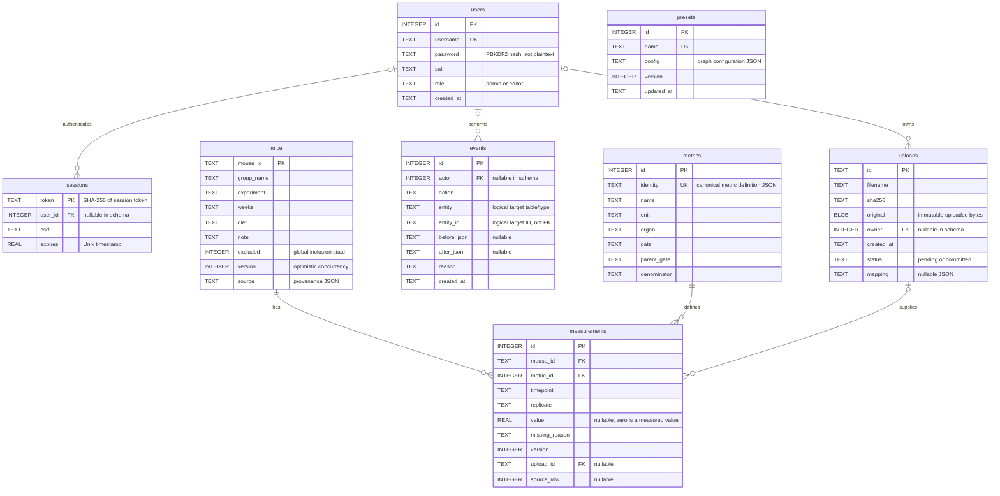
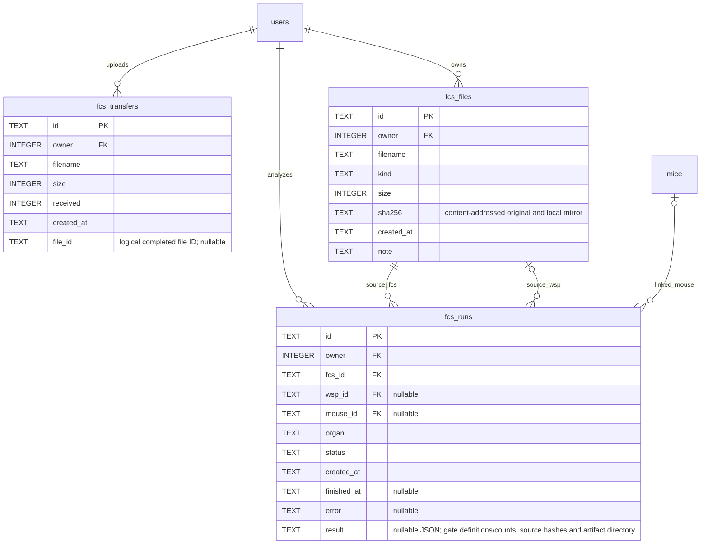
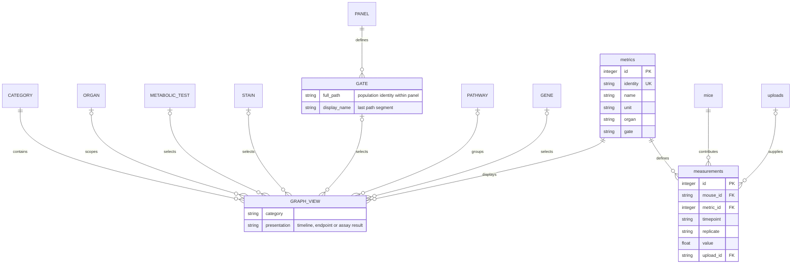

# Mouse Sanctuary — Database ERD

[Graph 측정 항목 분류 ERD와 선택 경로](#graph-metric-erd) · 실험팀 피드백, 2026-11-06

Verified against the running app's SQLite schema on 2026-11-03. Database: `/Users/paul/WorkInProgress/nplab_mouse_web/data/lab.sqlite`.

## Constraints and interpretation

- `measurements`: UNIQUE (`mouse_id`, `metric_id`, `timepoint`, `replicate`). Each mouse may have many metrics/gates and timepoints, with explicit replicate identifiers.
- Foreign-key lines above represent actual SQLite constraints. Optional parents reflect nullable foreign-key columns, even where normal application writes supply a user/upload ID.
- `events.entity` + `entity_id` reference targets logically; they are not enforced foreign keys. Audit events can describe users, imports, measurements, mice and presets.
- `presets` is a shared, independent table. Metric IDs and formatting are stored in `config` JSON, without SQL foreign keys.
- Exp, diet, organ and gate have no separate tables. Exp/diet are fields on `mice`; organ/gate are fields on `metrics`.
- Triggers prevent UPDATE/DELETE on `events`, UPDATE of `uploads.original`/`sha256`, and DELETE of `uploads`. Observation edits are versioned and audited by the application.
- Usernames can change without changing `users.id`; uploads and audit authors remain linked to that ID. Audit listings join the current username; rename events preserve the previous and new usernames.
- Password changes store a fresh salt and PBKDF2-HMAC-SHA256 hash, revoke all sessions for that user, and log the change without passwords/hashes/salts. The schema itself does not change for the account update.

## 한국어 설명

8개 테이블: 계정(users), 로그인 세션(sessions), 마우스 명단(mice), 측정 정의(metrics), 원본 업로드(uploads), 관측값(measurements), 변경 이력(events), 공유 그래프 서식(presets).

한 마우스의 여러 organ/gate 값은 서로 다른 metric의 관측값으로 저장합니다. 결측은 NULL로 저장하며 0과 구분합니다. 전역 제외는 mice.excluded에 저장하므로 원본 측정값은 삭제하지 않습니다.

## FCS extension (2026-11-03)

The original eight tables are retained. Three additional tables bring the current total to eleven. Files and per-event arrays are kept outside SQLite and must be included in backup bundles.

## Graph 측정 항목 분류 ERD

2026-11-06 실험팀 손그림을 바탕으로 정리한 논리 모델이다. 아래에서 대문자는 Graph 선택기에 쓰이는 개념이고, 소문자 `metrics`, `measurements`, `mice`, `uploads`는 SQLite 테이블이다.

| 대분류 | Graph에서 선택하는 순서 | 예시 |
|---|---|---|
| Metabolic outcome | 검사 또는 체중 보기 → 측정 항목 | Weight-timeline, Weight-endpoint, ITT, OGTT |
| Histology | 장기 → 측정 항목 | Liver → HE (%) 또는 PSR (%). 항목을 누르면 바로 그래프에 적용된다. |
| Flow cytometry | 장기 → 패널 → 마지막 gate 이름 → 측정 지표 | Liver → T Cell Panel → T-bet+ Tregs → Frequency. 다른 장기 예시는 Gut, Spleen이고, 패널 예시는 Treg Panel이다. |
| qPCR | 장기 → pathway → 유전자 | Liver → Fibrosis → Col1a1 또는 Col3a1. 다른 pathway 예시는 Lipid Metabolic과 Inflammation이다. |

손그림의 qPCR에는 **장기에서 유전자를 바로 선택하는 경로**도 있다. 예를 들면 Liver → Acta2 또는 Col1a1이다. 현재 선택기는 pathway를 거치는 방식이며, 직접 선택은 대안으로 기록한다. 아래 항목은 분류 예시이며 실제 메뉴에는 선택한 마우스에 수치가 있는 항목만 나타난다.

**관계 해석**

- `GRAPH_VIEW` 한 개는 대분류 하나와 측정 항목 하나를 연결한다. 나머지 연결은 대분류에 따라 달라진다. 예를 들어 Histology는 장기와 염색법을 사용하고, Flow cytometry는 장기와 패널에 속한 gate를 사용한다.
- 체중은 같은 `metric_id`라도 시점에 따라 주차별 추이와 endpoint 두 경로로 볼 수 있다. 두 경로에서 같은 관측값을 복사해 저장할 필요가 없다.
- FACS의 전체 경로는 `metrics.gate`에 보존한다. 예를 들어 `Cells/SingleCell/SingleCell/CD3+`는 **CD3+**로 표시한다. 같은 장기·패널에 이름이 같은 gate가 있으면 상위 경로로 구분한다. 각 gate에서 Frequency, MFI, Absolute Count는 별도의 측정 항목이다.
- Import에서 지정한 panel과 pathway는 `metrics.identity`에 포함된다. 한 유전자가 여러 pathway에 나타날 수 있고, 선택한 경로에서 연결된 측정 항목을 그린다.
- 관측값 한 건은 **Mouse ID × metric ID × timepoint × replicate**로 유일하다. 원본을 가져온 관측값은 `upload_id`와 `source_row`로 출처를 추적한다. 수치 0은 관측값이고, 결측은 `NULL`과 `missing_reason`으로 기록한다.
