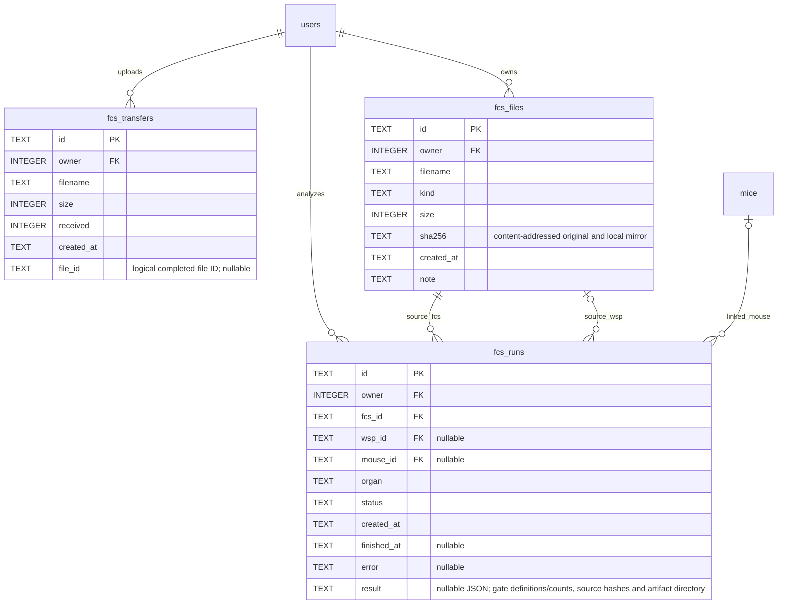

# Mouse Sanctuary — Database ERD

Verified against the running app's SQLite schema on 2026-11-03. Database: `/Users/paul/WorkInProgress/nplab_mouse_web/data/lab.sqlite`.

## Constraints and interpretation

- `measurements`: UNIQUE (`mouse_id`, `metric_id`, `timepoint`, `replicate`). Each mouse may have many metrics/gates and timepoints, with explicit replicate identifiers.
- Foreign-key lines above represent actual SQLite constraints. Optional parents reflect nullable foreign-key columns, even where normal application writes supply a user/upload ID.
- `events.entity` + `entity_id` reference targets logically; they are not enforced foreign keys. Audit events can describe users, imports, measurements, mice and presets.
- `presets` is a shared, independent table. Metric IDs and formatting are stored in `config` JSON, without SQL foreign keys.
- Exp, diet, organ and gate have no separate tables. Exp/diet are fields on `mice`; organ/gate are fields on `metrics`.
- Triggers prevent UPDATE/DELETE on `events`, UPDATE of `uploads.original`/`sha256`, and DELETE of `uploads`. Observation edits are versioned and audited by the application.
- Usernames can change without changing `users.id`; uploads and audit authors remain linked to that ID. Audit listings join the current username; rename events preserve the previous and new usernames.
- Password changes store a fresh salt and PBKDF2-HMAC-SHA256 hash, revoke all sessions for that user, and log the change without passwords/hashes/salts. The schema itself does not change for the account update.

## 한국어 설명

8개 테이블: 계정(users), 로그인 세션(sessions), 마우스 명단(mice), 측정 정의(metrics), 원본 업로드(uploads), 관측값(measurements), 변경 이력(events), 공유 그래프 서식(presets).

한 마우스의 여러 organ/gate 값은 서로 다른 metric의 관측값으로 저장합니다. 결측은 NULL로 저장하며 0과 구분합니다. 전역 제외는 mice.excluded에 저장하므로 원본 측정값은 삭제하지 않습니다.

## FCS extension (2026-11-03)

The original eight tables are retained. Three additional tables bring the current total to eleven. Files and per-event arrays are kept outside SQLite and must be included in backup bundles.

